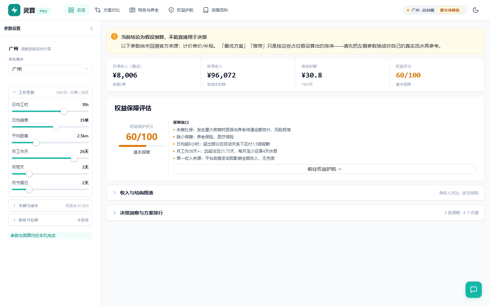
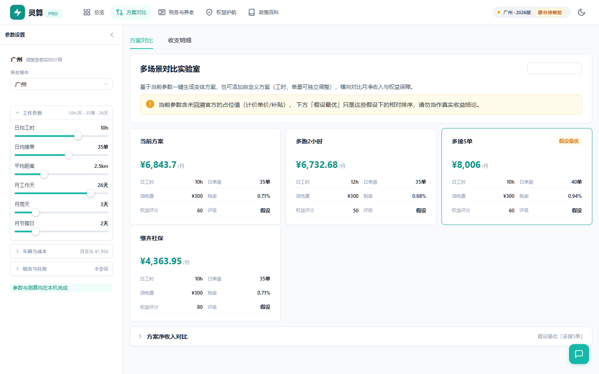
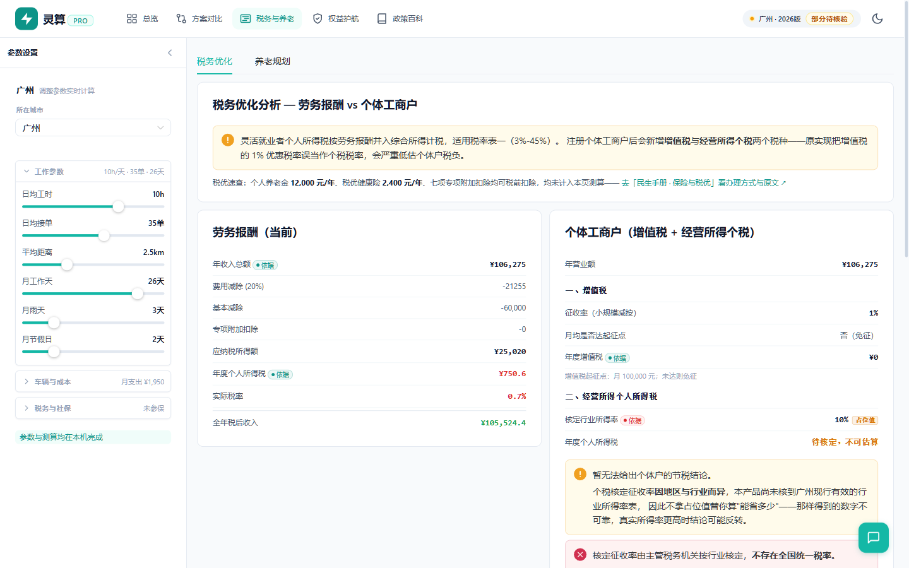
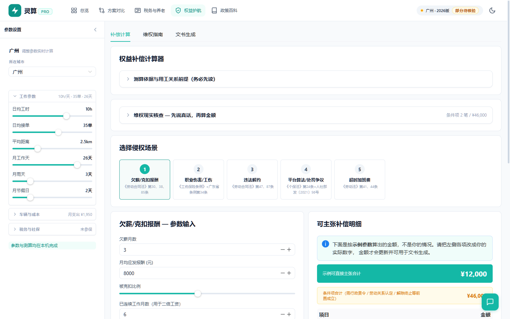
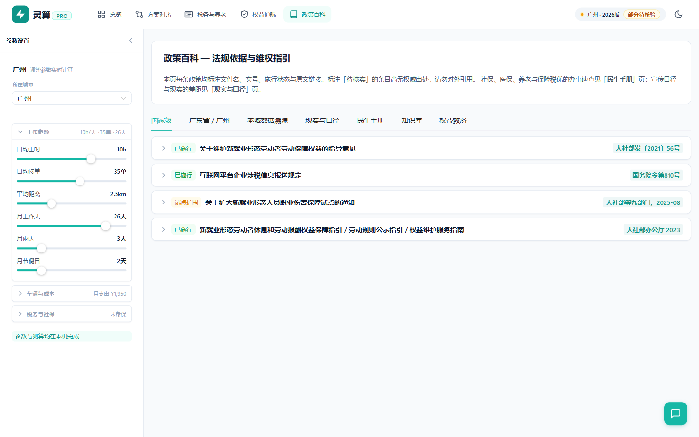

# 灵算 Pro — 灵活就业者收入精算与权益决策平台

[](https://github.com/badhope/flexcalc-pro/actions/workflows/ci.yml)
[](#测试覆盖什么)
[](#范围与设计主张)
[](#数据在哪里来自哪里)
[](LICENSE)

面向外卖骑手等灵活就业群体的收入 / 税务 / 社保 / 权益测算工具。纯前端，所有参数与测算结果默认只留在本机浏览器。

**唯一例外**：若你在「AI 助手」设置中主动启用并填入 API Key，则城市、工时、接单量、收入、成本、净收入、时薪、权益评分与最近 6 条对话会发送至**你自己填写的**第三方模型接口。本应用自身没有后端，不另存这些数据；不启用 AI 即完全离线。

## 截图

**总览** — 净收入、有效时薪与权益评分。当测算依赖的字段尚未回溯到官方来源时，顶部会明确标出「假设测算」并列出具体字段，不做确定性结论。



**方案对比** — 按当前参数生成变体方案横向对比；占位数据下「最优」降级为「假设最优」。



**税务与养老** — 劳务报酬与个体工商户两套税种分列；未核到现行核定所得率时不替用户估算节税金额。



**权益护航** — 补偿金额按「可直接主张」与「条件项」分列；首屏示例值明确标注，避免被当成用户主张金额。



**政策百科** — 15 城参数逐条溯源，每条带文号、原文链接、生效日与核取日。



## 范围与设计主张

已收录 **15 座城市**（广州 / 深圳 / 东莞 / 北京 / 天津 / 上海 / 杭州 / 南京 / 苏州 / 武汉 / 长沙 / 郑州 / 成都 / 重庆 / 西安），可在地图选择器中切换。每座城市的社保、医保与最低工资参数逐条挂在 `sources` 里，界面按字段显示置信度：

- **official** — 已回溯到主管部门原文页面（含文号与链接）
- **derived** — 据官方口径推算，非直接发布值
- **unverified** — 无权威来源，仅作占位

当前 15 城中：最低工资有 7 城为 official（北京/上海/杭州/南京/苏州等仍为 `unverified`，待补）；养老金计发基数仅长沙、天津为 official，其余多为 `derived`；**平台接单计价 15 城全部为 `unverified`**——它属平台商业规则，不存在跨平台权威来源，必须由用户替换为自己 APP 内的实际计价。

产品立场：**宁可显示"待核验"，也不以官方口径的名义展示未经核实的数字。** 当测算所依赖的字段未核实到官方来源时，首页会把「最优方案」「推荐」降级为「假设测算」并列出具体字段（`src/utils/dataQuality.ts`）。

## 个税算的是什么口径（重要）

本产品算的是**年度汇算清缴口径**：劳务报酬收入额按减除 20% 费用后并入综合所得，减除费用按 5000 元/月累计，适用**个人所得税税率表一**（3%–45%）。每次收入不超过 4000 元的，按 800 元减除费用（个人所得税扣缴申报管理办法第八条）。

**这不是平台代扣口径。** 若平台成为扣缴义务人，真实预扣预缴应改用国家税务总局公告2018年第61号附件2 的**预扣率表二**（20%/30%/40%，速算扣除 0/2000/7000）按次计算，与本口径差异可能很大。本产品的税额不代表平台应扣金额，请以主管税务机关核算为准。

## 快速开始

```bash
npm ci
npm run dev          # http://localhost:3000（Web）
npm run tauri:dev    # 桌面端（需 Rust 工具链）
npm test             # vitest，852 例
npm run verify       # 引擎自检：净收入恒等式闭合
npm run build        # vue-tsc --noEmit && vite build
npm run tauri:build  # 桌面端安装包
```

## 代码分层

```
src/
├── domain/          纯业务逻辑，零框架依赖，可独立单测
│   ├── shared/      Brand 类型、Money/Rate 值对象、Result 统一错误处理
│   ├── income/      收入与成本引擎（端口 + 纯函数 + 实现）
│   ├── tax/         劳务报酬个税、个体户核定征收
│   └── benefit/     社保缴费、退休测算
├── application/     用例编排：ScenarioService / CompensationService / RightsService
│                    全部返回 Result<T, AppError>，不向外抛异常
├── infrastructure/  适配器：localStorage / IndexedDB / HTTP 规则加载 / 密钥 / 日志
├── engine/          旧引擎，**仅作为对拍基准保留**（ScenarioEngine / IncomeEngine
│                    已无生产调用方；TaxEngine / BenefitEngine 仍被税务与退休面板使用）
├── stores/          Pinia 状态与参数持久化（编排已切到 application/ScenarioService）
├── components/      UI 组件与面板
└── views/           五个页面
```

分层原则：domain 不依赖 Vue/框架/网络；application 只做编排不含公式；
infrastructure 承担全部 I/O 与副作用。**异步边界被隔离在 infrastructure**——
领域层的规则提供端口保持同步，网络不确定性不泄漏进计算逻辑。

## 换算约定

- domain 层金额一律用**分**（整数）运算，杜绝浮点误差
- 对外契约与 UI 一律用**元**
- 换算只发生在 `application/adapters/ruleAdapters.ts` 与 ScenarioService 的结果边界，
  业务代码中不允许出现裸的 ×100 / ÷100

## 等价性保障

`tests/parity/` 下有两组对拍，是「重构没有改变用户看到的数字」的护栏：

| 文件 | 覆盖 |
|---|---|
| `old-vs-domain.spec.ts` | 引擎级：广东 3 城（广/深/莞）× 收入/个税/社保/退休逐位比对到分（150 例） |
| `scenario-service.spec.ts` | 端到端：整条编排链，含权益评分、洞察文本、排序摘要（213 例） |

对拍锁定的是新旧实现的一致性，因此只需取有旧引擎基准的广东 3 城；全国 15 城的
**数据完整性**由 `tests/cities.spec.ts` 覆盖（注册表↔规则文件同步、必需字段、
费率区间、official 必须有链接、占位城市必须写明原因），**置信度门禁**由
`tests/dataQuality.spec.ts` 覆盖（全 15 城扫描 `provisional` 标记与依赖清单一致性）。

`src/engine/ScenarioEngine.ts` 与 `src/engine/IncomeEngine.ts` 已无生产调用方，
**专供对拍使用**。修改方案编排请改 `ScenarioService`，让对拍告诉你哪里不一致。

## AI 助手与你的 API Key

支持 OpenAI 兼容接口（DeepSeek / Qwen / GPT 等）。三条安全约束：

- **Key 默认不持久化**，只存在于内存，关闭标签页即失效。勾选「在本机记住」后才会以明文写入本浏览器 localStorage
- **Endpoint 强制校验**：非本机地址必须 `https`，拒绝相对路径与内嵌用户名密码的 URL（`https://legit.com@evil.com` 这类钓鱼写法），设置弹窗实时显示 Key 将发往哪个主机
- **失败信息不外泄**：服务端错误体只留在浏览器 console，聊天气泡里显示的是按状态码本地化的文案

## 数据在哪里，来自哪里

`public/rules/{city}.json` 是唯一数据源，每个外部参数都在 `sources` 里挂 `docNo` / `url` / `effectiveFrom` / `retrievedAt` / `confidence`：

| confidence | 含义 | 约束 |
|---|---|---|
| `official` | 已回溯官方原文 | 必须有文号或链接 |
| `derived` | 依官方口径推算 | 需写明推算依据 |
| `unverified` | 无权威来源 | 仅作占位，禁止对外引用 |

已核对的主要依据（持续更新；各条 `retrievedAt` 为实际核取日）：

**广东（广州 / 深圳 / 东莞）**

- 粤人社发〔2026〕24号 — 2026 年职工基本养老保险缴费基数上下限。**下限 2026-01-01 起全省统一为 5510 元；自 2026-07-01 起调整为 5521 元（当前生效值），上限 27603 元**，不再划分片区
- 粤人社规〔2026〕14号 — 广东省灵活就业人员参加企业职工基本养老保险办法（第七条 20%，12% 统筹 + 8% 个账）
- 穗医保规字〔2026〕4号 — 广州市职工医疗保险和生育保险筹资标准（2027-01-01 施行，2026 年内沿用〔2022〕1号，实体内容一致）。灵活就业人员按缴费基数 **8%** 缴纳；2026 年度基数上限 **31170**、下限 **6234**
- 深圳市医疗保障局公告（2025-12-29）— 深圳职工医保 2026 年度基数下限 **6727**、上限 **33633**；灵活就业人员费率自 2026-01-01 起由 7% 恢复为 **8%**
- 东莞市医疗保障局《2026年度医疗保险缴费基数和费率表》 — 东莞职工医保基数下限 **4775**、上限 **27549**。灵活就业人员**分档收费**，本产品在参数栏提供档次切换：
  - 单建统筹（无个人账户）**3.65%**（默认；2026-07-01 起按东府规〔2026〕5号由 3.5% 调整）
  - 统账结合（无个人账户）**4.3%**
  - 统账结合（有个账）**6.3%**，另可自愿参加大额补助 0.5%
  - 三档的单位和个人部分均由灵活就业者本人承担
- 广东省人民政府 2026 年最低工资调整通知 — 广州 2680 元/月、深圳 2700 元/月，非全日制 25.4 元/小时（2026-09-01）；东莞二类 2300 元/月
- 养老金计发基数 — 广东省（不含深圳）**9493** 元/月，深圳单列 **11293** 元/月。基础养老金按 国发〔2005〕38号公式 `计发基数×(1+平均缴费指数)÷2×缴费年限×1%` 计算，缴费指数低于 0.6 按 0.6 计。**该基数值见于省市人社部门公开答复与多家一致报道，尚未回溯到发布本基数的规范性文件文号，故标 `derived`**

**其他省市（2026-10-15 新增核定）**

- 成都 — 养老/医保基数 上限 **23493**、下限 **4699** 元/月（四川省人社厅 川人社办发〔2026〕50号）；最低工资第一档 **2330** 元/月（川府规〔2024〕4号）
- 重庆 — 基数 上限 **22765**、下限 **4553** 元/月，含以个人身份参保人员（渝人社规〔2026〕18号）；最低工资第一档 **2330** 元/月
- 武汉 — 第 1 档 上限 **22488**、下限 **4498** 元/月（鄂人社发〔2025〕28号，2026 年度官方尚未发布）；最低工资第一档 **2400** 元/月（鄂政办发〔2025〕44号）
- 西安 — 养老 上限 **23685**、下限 **4737** 元/月（陕人社函〔2026〕326号）；医保另口径 上限 **24948**、下限 **4990** 元/月（2025 年度）；最低工资一类区 **2376** 元/月（陕人社发〔2026〕4号）
- 郑州 — 基数基准 **6520** 元/月，60% 为 **3912**、300% 为 **19560**（豫人社办〔2026〕62号，2026-07-01 起）；最低工资一类区 **2350** 元/月（豫政〔2025〕25号）
- **上述 5 城的「养老金计发基数」仍未核实**：穷尽省人社厅站内检索、政府门户搜索与多轮关键词后未找到官方公布文件（检索到的均为养老金「调整」通知，非计发基数），故保持 `unverified` 并在 `note` 写明。该项直接决定基础养老金，未核实前界面会标示为占位

- 国务院令第 810号 — 互联网平台企业涉税信息报送规定。**注意：官方解读明确配送、运输、家政等便民劳务从业人员的收入信息免予报送**，本产品的个税测算属自行申报口径估算，不是平台代扣结果
- 《工伤保险条例》第 33–37、62、64 条 与《广东省工伤保险条例》（2019 修正）第 34 条 — 一次性伤残补助金、医疗补助金、就业补助金月数表

平台接单计价（起步价、距离费率、时段与天气补贴、冲单奖）**没有跨平台权威来源**，属商业规则，文件中标为 `unverified`。用户应替换为自己 APP 内的实际计价与流水。

峰时补贴按「峰时段总时长 ÷ 日均工时」折算（广州默认参数下为 60%），工时超过峰时总时长时封顶 100%。若不折算，默认参数下毛收入会虚高约 455 元/月。

## 个体工商户税负为什么拆成两项

早期版本把**增值税的 1% 优惠税率**当成了个人所得税核定征收率（`TaxOptimizer.vue` 文案写"核定税种（增值税1%，个税核定）"），这会把个体户税负严重低估。两者是不同税种、不同文号、不同口径：

| 税种 | 依据 | 本产品处理 |
|---|---|---|
| **增值税** | `财政部 税务总局公告2026年第10号` 第三条(六)6：小规模纳税人依 3% 征收率**减按 1% 征收增值税**（2026-01-01 至 2027-12-31）；第一条：月销售额 10 万元为起征点 | 有国家层面统一文号，`official`，可独立估算 |
| **经营所得个税** | 核定征收走「行业所得率法」（`国家税务总局广东省税务局公告2018年第22号`、`粤税发〔2018〕79号`），**行业所得率由各省市税务局按行业分别核定，不存在全国统一税率** | 未核到各城现行有效的行业所得率表，`unverified`，占位 10% |

因为个税部分是 `unverified`，**税务页不会用它替你算"注册个体户能省多少"**——用未核实的税率得出结论是不可靠的，真实所得率更高时结论可能反转。页面在该情形下只展示增值税，并把个税标为「待核定，不可估算」。

核定征收公式（`粤税发〔2018〕79号`）：应纳税所得额 = 经营额 × 行业所得率 − 费用减除标准 × 实际经营月数，再套经营所得税率表（5%-35%）。`TaxEngine.calcSoleProprietorship` 已实现该公式，税率表与费用减除标准均由规则文件承载。

## 已知边界（重要）

- 多数外卖骑手与平台被认定为"不完全符合确立劳动关系情形"。此时以劳动关系为前提的项目（加班费、二倍工资、违法解除赔偿金、工伤保险待遇）**可能全部不适用**，需走民事服务合同 / 侵权路径。权益补偿页顶部有同等提示。
- 补偿计算金额分为「可直接主张」与「条件项」两类，后者需行政责令、劳动关系认定或解除/终止等前置条件成立，**不计入合计**。
- **缴费基数可在上下限内自选**（粤人社规〔2026〕14号第六条）。默认按你的申报收入计算，但参数栏提供自选滑块：月入 30000 时按申报收入（封顶）需缴 ¥7921，自选最低档只需 ¥1603，**差额 ¥6318/月**。选低基数当期省得多，但会拉低退休时的平均缴费指数，基础养老金随之减少——参数栏与洞察提示都会写明这一点
- 退休测算的**账户收益率是自设假设**（规则文件里当前为 3%），不构成养老待遇核定；计发基数取自省市人社部门公开答复口径，深圳单列值与广东省值不可互换
- 东莞医保分档由用户在参数栏自行选择，默认单建统筹（成本最低档）；若用户实际参加统账结合并参加大额补助，需自行切换档次后再比较，否则参保成本会被低估。该选择会随参数一起持久化
- 全部内容为信息参考，不构成法律、税务或社保意见。免费咨询：12348 法律援助、12333 人社热线、12351 工会维权热线。

## 测试覆盖什么

`tests/engines.spec.ts` 用手算基准值卡住计算与数据可信度：

- 收入分项之和恒等于毛收入（防止事后改写导致表内与图表不一致）
- 累计预扣法全年税额对上个人所得税预扣率表手工推算
- 养老 / 医保基数上下限夹取、未参保个人支出为 0 但缺口仍标记、职业伤害保障不计入个人支出
- 净收入恒等式闭合、权益评分落在 0–100
- 参保降低净收入但提高权益评分；**未参保方案评级封顶为"可行"**，避免工具反向建议骑手不参保
- **每城的养老/医保基数与费率锁定为该城官方原文值**（当前锁广东 3 城），且断言三城医保基数互不相同——防止再次出现"深圳抄广州""东莞抄估算值"
- **退休基础养老金按 国发〔2005〕38号 公式由规则文件的计发基数算出**，个人账户养老金按 139 个月除算；深圳计发基数须为 11293，广州/东莞须为 9493；缴费指数低于 0.6 时按 0.6 计
- **个税税率表口径自述正确**：标题必须指向税率表一，`method` 必须是 `annual_consolidated`，且 note 中保留与预扣率表二的差异说明
- **4000 元减除分支**：月收入 3900 与 4100 分别走 800 元与 20% 两个分支，阈值由规则文件承载而非写死在代码里
- **越界输入不产生 NaN / Infinity**：`workDaysMonth=0`、`dailyHours=0`、负工作天数、`dailyOrders=NaN` 均产出有限数值，收入分项符号一致
- **参数读写对称**：`medicalTierId` 与自选缴费基数刷新后必须读回；非有限值与越界值被夹取，区间内的正常值原样保留；`vehicleType` 这类联合类型做枚举校验
- **缴费基数可自选**：指定最低档时月缴按 `baseMin` 计；未指定时保持按申报收入夹取；自选值越界时被夹回规则区间
- **endpoint 校验**：拒绝 http、相对路径、非法 URL、内嵌凭据的 URL；接受 https 并返回 host；models 地址推导覆盖 Azure 的 deployments 形态
- **增值税与个税口径分离**：各城 `soleProprietorship` 配置中增值税与个税分列且各有来源；旧字段 `tax.soleRate` 不得残留（CI 校验阻断）
- **核定征收公式正确实现**：应纳税所得额 = 经营额 × 行业所得率 − 费用减除 × 12，再套 5%-35% 经营所得税率表；低收入时税额为 0；12 期之和等于年度税额
- **占位值不得驱动节税结论**：个税核定来源为 `unverified` 时，UI 不得展示节税金额，只展示增值税
- **峰时补贴按占比折算**：`peakHours` 合计时长 ÷ 日均工时，上限 100%；折算后工时上升时峰时补贴下降，故"多跑 2 小时不减少净收入"这类旧断言须改写为锁定基础计件不变
- **年度与月度净额闭合**：`netAnnual` 与 `netMonthly×12` 差在 0.1 元内；`effectiveRate` 不再双重取整
- 东莞三档医保费率必须分离，且外地城收到东莞档次 id 时回落默认档（跨城不串值）
- 规则文件溯源约束：official 必须有文号或链接、`verified` 不得与实际置信度冲突、平台计价必须标 `unverified`

CI（`.github/workflows/ci.yml`）跑类型检查、测试、构建与规则文件溯源校验。
